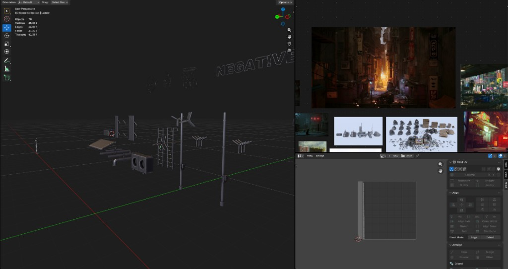
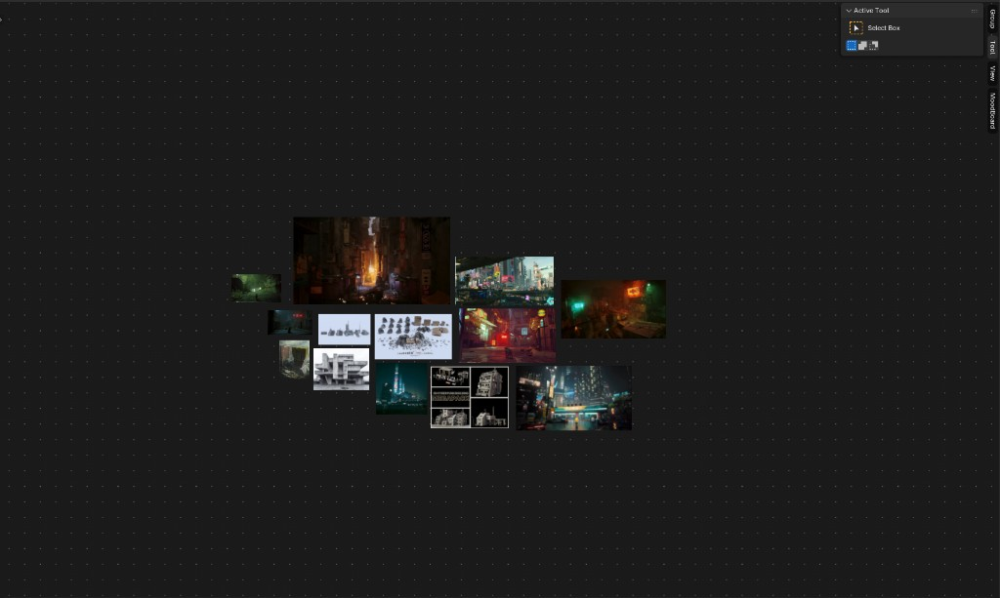

# MoodBoard

**Your references. Inside Blender.**

MoodBoard is a dedicated editor for image collages - drop refs from disk or the browser, arrange them next to your viewport, and keep working without alt-tabbing.

  
  
  

  

  

---

## Why MoodBoard

| | |
|---|---|
| **Own editor** | Split a view and open MoodBoard like UV or Geometry Nodes |
| **Browser drops** | Drag images from Google / Chrome onto the board |
| **PureRef import** | Load legacy PureRef 1.x `.pur` scenes (2.0+ coming later) |
| **On-canvas controls** | Move, scale, rotate — multi-select with one group box |
| **Fast boards** | Texture caching + view culling for large collages |
| **Stays in the file** | Boards and packed images save with your `.blend` |

---

## Install

1. Download **`moodboard.zip`** from the [latest release](https://github.com/relapsecycle/moodboard/releases/latest)
2. Blender → **Edit > Preferences > Add-ons > Install from Disk**
3. Pick `moodboard.zip` and enable **MoodBoard**

Needs **Blender 4.2+**.

---

## Quick start

1. Split an area
2. Editor type menu → **MoodBoard**
3. Sidebar (`N`) → **MoodBoard** → **New Board**
4. Drop images, import a folder / legacy `.pur`, or **Ctrl+V** paste
5. Drag to move · corner squares to scale · blue knob to rotate

Done. Save the blend - your board comes with it.

---

## Controls

| Action | How |
|---|---|
| Add images | Drop files / browser images, Import Folder, Add Image, or Ctrl+V |
| Move | Drag the image |
| Scale | Drag a corner square |
| Rotate | Drag the blue top knob |
| Multi-select | Shift+click images, then move / scale / rotate together |
| Pan / zoom | Middle mouse / scroll |

**Tip:** If a browser drag fails, right-click the image → **Copy image** → **Ctrl+V** in MoodBoard.

---

## Requirements

- Blender 4.2 or newer
- Windows for clipboard paste and best browser-drop support
- Network permission when downloading images from web drops

---

## License

GPL-3.0-or-later (same family as Blender add-ons).

---

Made by [ADDICT](https://github.com/relapsecycle)
